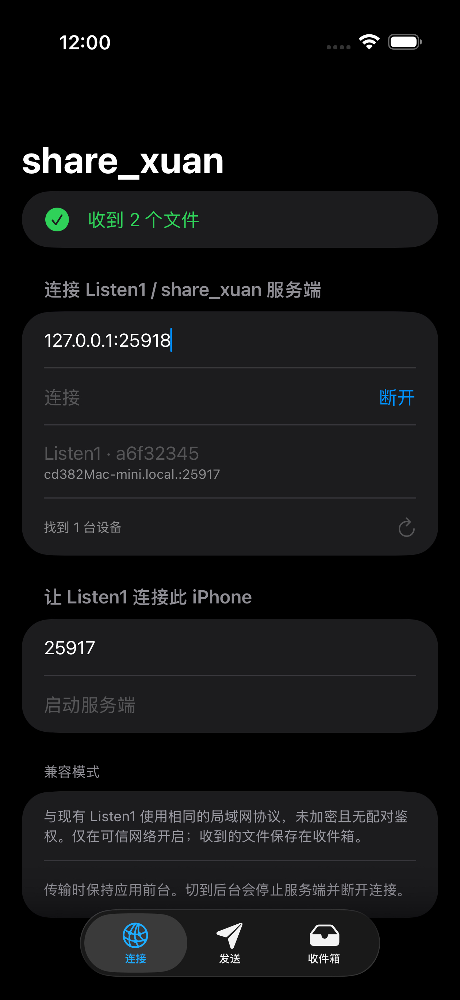
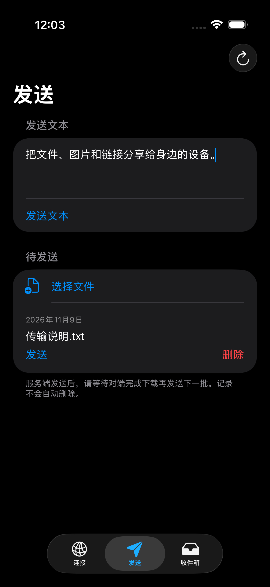
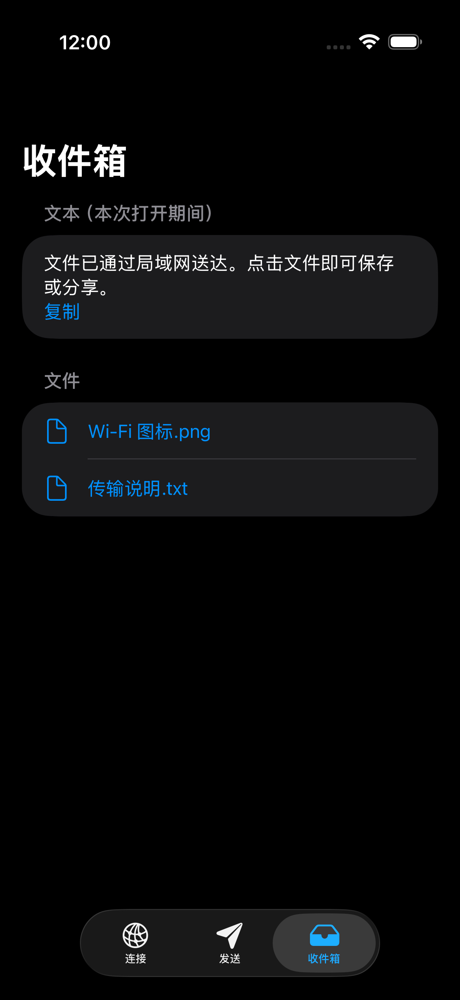
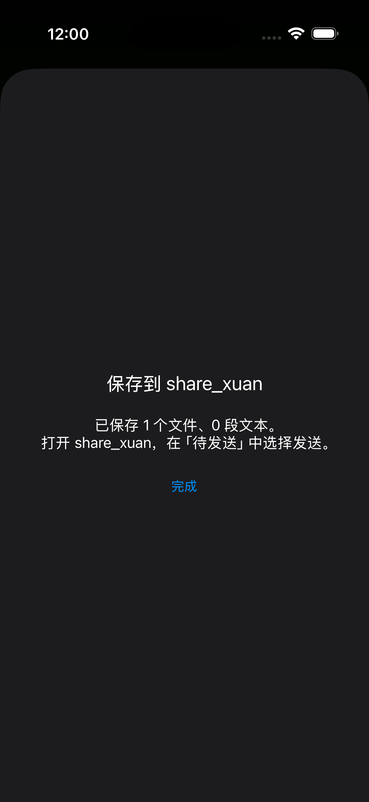
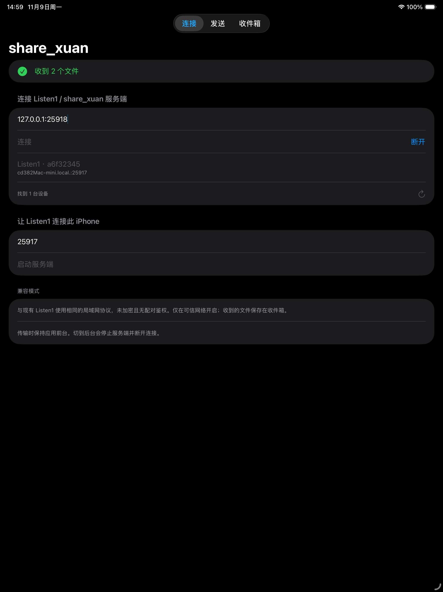
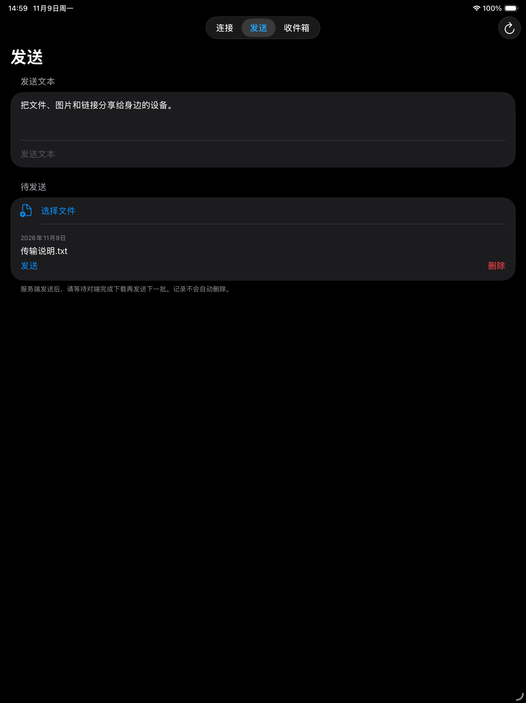
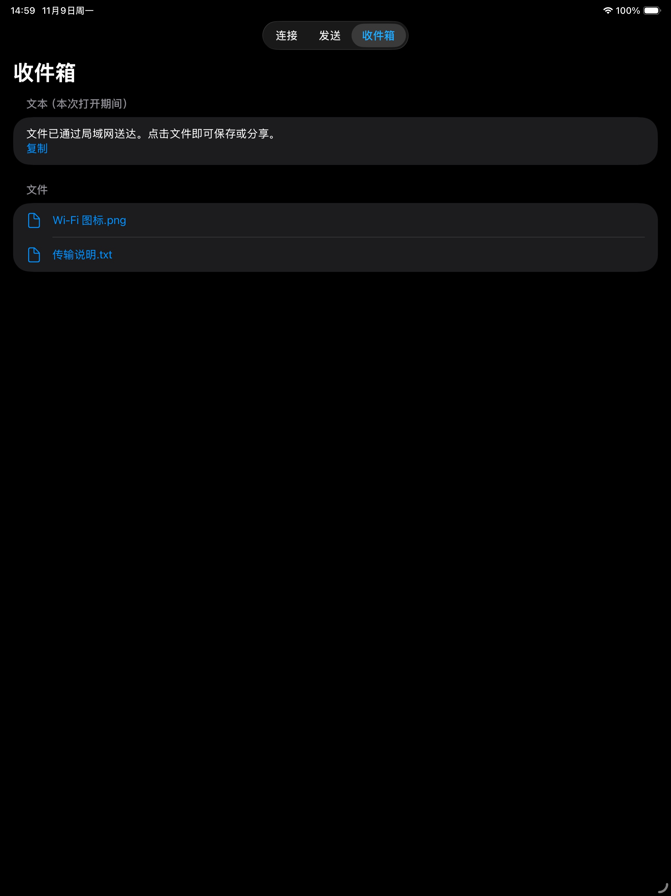
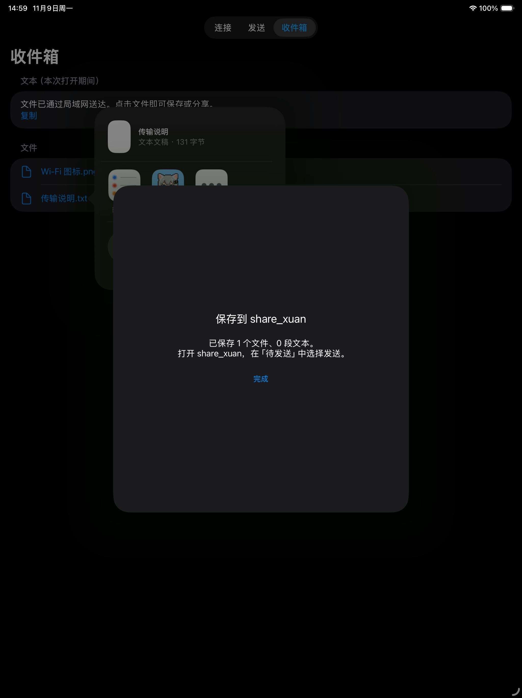

# 真实截图（iPhone / iPad）

## iPhone Air

2026-11-09，从已有 iPhone Air / iOS 26.5 模拟器截取，运行 Bundle ID `xyz.040905.share`，深色模式。未生成或重绘界面、未添加营销文案、未缩放。

- `iphone-air/`：simctl 导出的原始 PNG，1260×2736（有 alpha 通道）。
- `app-store-iphone-air/`：同尺寸高质量 JPEG，无 alpha，可用于对应的 App Store Connect iPhone 截图槽位；不包含模拟器外框。
- 演示内容通过本机回环地址上的真实 HTTP/WS 测试对端接收。文件为本次创建的「传输说明.txt」和新图标，未使用私人文件。
- 待发送文件通过实际系统分享扩展导入，发送框文字仅为演示草稿，没有发送至用户的 Listen1 实例。
- 连接页保留了当时 Bonjour 发现的局域网设备名称。截图反映真实状态，没有修图替换地址。
- iPad 截图见下方 iPad 小节。

| 连接与设备发现 | 文本与文件发送 |
| --- | --- |
|  |  |

| 收件箱 | 系统分享扩展 |
| --- | --- |
|  |  |

## iPad Air 13 英寸

2026-11-09，从已启动的 iPad Air 13 英寸 (M4) / iOS 26.5 模拟器截取，运行 Bundle ID `xyz.040905.share`，深色模式。未生成或重绘界面、未添加营销文案、未缩放。

- `ipad-air-13/`：simctl 导出的原始 PNG，2048×2732。
- `app-store-ipad-air-13/`：同尺寸 JPEG，无 alpha，可用于 App Store Connect 13 英寸 iPad 截图槽位；不包含模拟器外框。
- 与 iPhone 组同样使用本机回环地址 `127.0.0.1:25918` 上的临时 HTTP/WS 测试对端：欢迎帧、一段文本、一次两文件推送。测试对端仅在截图期间运行，未连接或改写用户的 Listen1 实例。
- 待发送记录由本次创建的「传输说明.txt」写入 App Group 待发送目录；演示图为应用自身图标，未使用私人文件。
- 连接页保留当时 Bonjour 发现的真实局域网设备名称，没有修图替换地址。
- 系统分享扩展截图由收件箱文件触发真实分享菜单、点击 `share_xuan` 扩展后截取；iPad 上扩展以居中卡片呈现，背景为系统的分享菜单，未做任何修饰。
- 状态栏时间为截取时的真实系统时间；`simctl status_bar override` 在 iOS 26.5 上对该设备返回 `Invalid argument`，未使用。
- iPad 版界面为同一 SwiftUI `TabView` 的常规宽度布局，内容区两侧留白，属于当前实现的实际形态。

| 连接与设备发现 | 文本与文件发送 |
| --- | --- |
|  |  |

| 收件箱 | 系统分享扩展 |
| --- | --- |
|  |  |

尺寸参考：[Apple 截图规格](https://developer.apple.com/help/app-store-connect/reference/app-information/screenshot-specifications)。最终以 App Store Connect 对当前应用显示的截图槽位要求为准。
